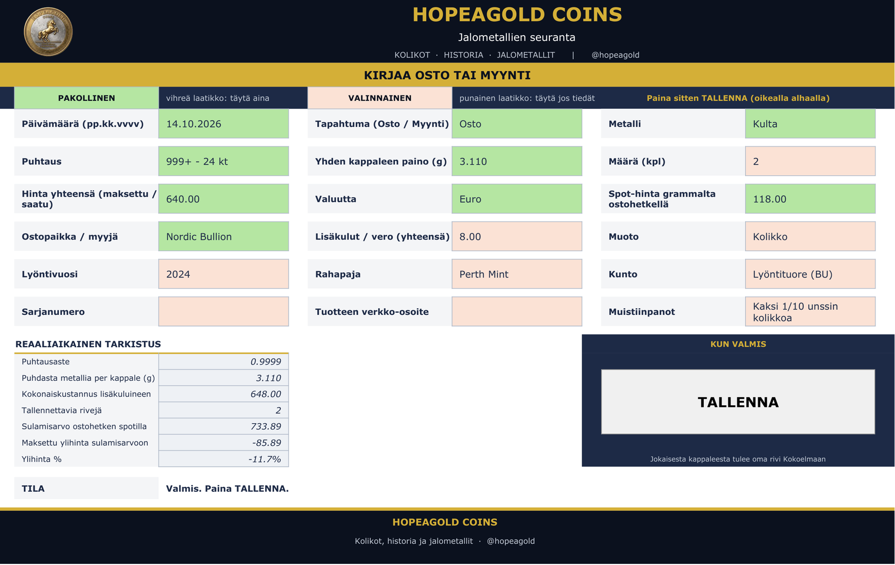
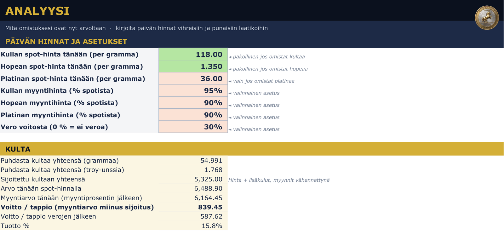
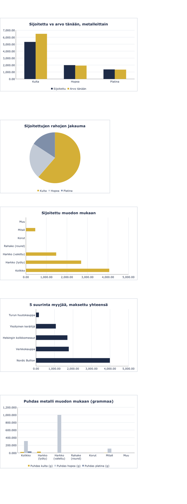
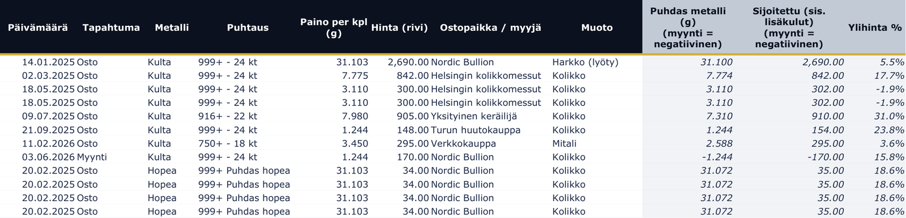
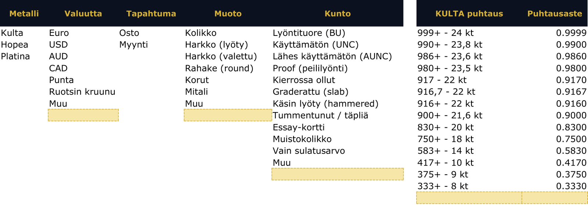
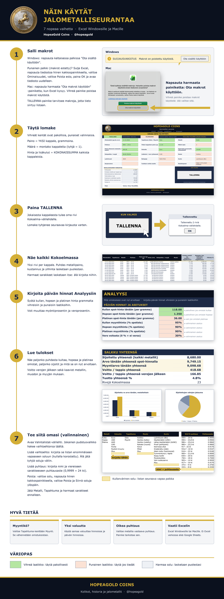

# HopeaGold Jalometallien seuranta (Excel)

**Seuraa jokaista kulta-, hopea- ja platinakolikkoa ja -harkkoa Excelissä.** Yksi lomake, yksi painike: näet puhtaan metallisi, sijoitetut eurot, arvon tänään ja voiton kaavioineen. Ei sovellusta eikä tilausta, tietosi pysyvät omassa tiedostossasi.

### [Hanki täysi seuranta Gumroadista](https://hopeagold.gumroad.com/)

> Tässä repossa on **vain katseltava esimerkki**: pelkät arvot, ei makroja, lukitut välilehdet. Täysi seuranta (TALLENNA-painike, kaikki kaavat, muokattavat pudotusvalikot ja esimerkkitiedosto) on myynnissä Gumroadissa.

## Mitä täysi seuranta tekee

- Kirjaa osto tai myynti yhdellä lomakkeella. Vihreät laatikot ovat pakollisia, punaiset valinnaisia.
- Ostitko useita samanlaisia kolikoita tai harkkoja? Kirjoita määrä, niin jokaisesta tulee oma rivi.
- Omat puhtauslistat kullalle (24 kt – 8 kt), hopealle (999, Britannia, sterling, kolikkohopea, 800) ja platinalle (999, 950, 900, 850).
- Puhdas metallipaino grammoina ja unsseina, kokonaiskustannus lisäkuluineen, sulamisarvo ja ylihinta jokaiselle riville.
- Kirjoita päivän hinta grammalta: näet arvon tänään, myyntiarvon, voiton ja voiton verojen jälkeen.
- Kaaviot: sijoitettu vs arvo, rahojen jakauma, kulut muodon mukaan ja 5 suurinta myyjää.
- Tallenna jokaisesta kappaleesta vuosi, rahapaja, kunto, sarjanumero, muistiinpanot ja linkki.
- Muokkaa kaikki pudotusvalikot (valuutat, muodot, kunnot, puhtaudet) omiksesi. Kolme metallia on kiinteä.

## Näin se toimii

1. Avaa Lomake ja täytä vihreät laatikot.
2. Paina TALLENNA. Jokaisesta kappaleesta tulee oma rivi Kokoelma-välilehdelle.
3. Avaa Analyysi, kirjoita päivän hinnat ja lue tulokset.

## Kokeile esimerkkiä

Avaa [`demo/HopeaGold-Jalometallit-Seuranta-DEMO.xlsx`](demo/HopeaGold-Jalometallit-Seuranta-DEMO.xlsx) Excelissä ja tutustu oikeaan ulkoasuun esimerkkitiedoilla. Se on vain katseltavaksi.

## Vaatimukset (täysi seuranta)

Excel Windowsille tai Macille (Excel 2016 tai uudempi, tai Microsoft 365). TALLENNA-painike käyttää makroa, joten makrot on otettava käyttöön: Windowsissa napsauta Ota sisältö käyttöön (poista ensin esto ladatulta tiedostolta), Macissa harmaata Ota makrot käyttöön -painiketta. Ei toimi Excelissä verkossa, Google Sheetsissä eikä puhelinsovelluksissa. Kuvaopas on mukana.

## Haluatko rakentaa sen itse? (8 €)

Haluatko rakentaa oman versiosi alusta alkaen tekoälyavustajan avulla? Maksa **8 €** Buy Me a Coffee -palvelussa: **[buymeacoffee.com/hopeagold](https://buymeacoffee.com/hopeagold)** ja kirjoita viestiin sähköpostiosoitteesi. Lähetän sinulle rakennusohjeen (prompt) ja Excel-tiedoston 48 tunnin kuluessa.

## Tuki

Täyden seurannan jokainen ostaja saa yhden ilmaisen tukikysymyksen. Sen jälkeen tuki maksaa 2 euroa per yhteydenotto, ja vastaan jokaiseen parhaani mukaan.

## Lisenssi ja vastuun rajaus

Copyright (c) 2026 HopeaGold: Coins, History and Precious Metals. Kaikki oikeudet pidätetään. Esimerkkitiedoston saa ladata ja katsoa vain henkilökohtaista arviointia varten; älä kopioi, jaa, myy tai käytä sitä tai täyden tuotteen ulkoasua uudelleen. Katso [LICENSE](LICENSE).

Tämä on kirjanpidon apuväline. Arvot perustuvat antamiisi hintoihin ja ovat arvioita. Se ei ole sijoitus-, vero- tai muuta neuvontaa. Microsoft Excel on Microsoft Corporationin tavaramerkki; tämä tuote on riippumaton, eikä Microsoft ole sen kumppani tai suosittelija.

## Tietoa meistä – HopeaGold: Coins, History and Precious Metals

HopeaGold: Coins, History and Precious Metals on suomalainen keräilybrändi hopea- ja kultakolikoille sekä jalometalleille. Nimi yhdistää sanan "hopea" ja englannin sanonnan "hope a gold". [Facebook](https://www.facebook.com/hopeagold) · [YouTube](https://www.youtube.com/@hopeagold) · [X](https://x.com/hopeagold) · [Instagram](https://www.instagram.com/hopeagold/) · [Gumroad store](https://hopeagold.gumroad.com/) · [Tue meitä kahvilla](https://buymeacoffee.com/hopeagold)

`#jalometallit` `#sijoituskulta` `#kolikot` `#numismatiikka` `#exceltaulukko` `#seuranta`
